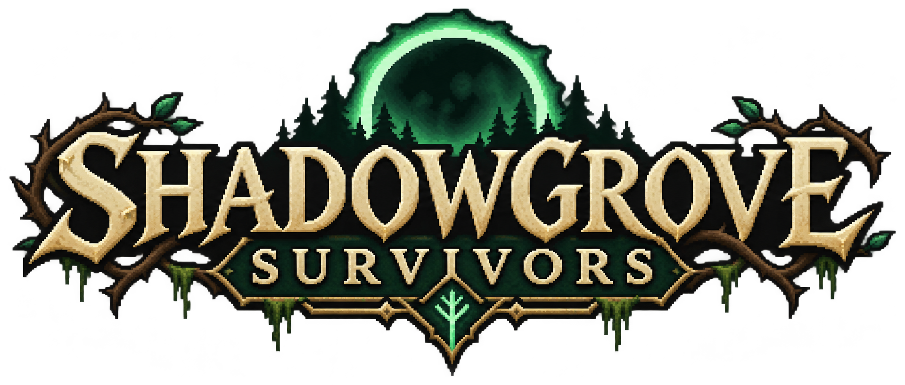
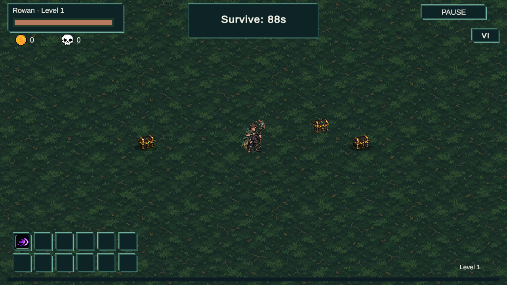

# Shadowgrove Survivors



Đồ án game Unity 2D thuộc thể loại survivors roguelike, với chủ đề rừng cổ và phong cách Nhật Thực Ngọc Bích. Phiên bản này được phát triển và duy trì bởi [khanhanprovip](https://github.com/khanhanprovip), dựa trên Survivors Roguelike Kit của Roo-Roo-Roo.



## Nội dung hiện có

- Ba nhân vật: Rowan, Lyra và Kael; sprite, portrait và animation Idle/Run/Attack.
- Mười màn chơi với nền riêng; ba chế độ Survival, KillTarget và Endless.
- Survival thắng sau 90 hoặc 120 giây tùy màn; KillTarget thắng ở 30 kill; Endless tăng độ khó và kết thúc khi người chơi chết.
- UI tiếng Việt/Anh: menu, chọn nhân vật/màn, chuẩn bị trận, HUD, kỹ năng, cài đặt, tạm dừng và kết quả.
- Bộ hình quái/boss, icon và VFX theo cùng phong cách; nháy đỏ nhẹ khi nhận sát thương.
- Rương nhận 50 vàng trong trận khi chạm; chống nhận lặp.
- Âm thanh, save, nâng cấp và các công cụ kiểm thử Unity/Windows.

Bộ chiêu khởi đầu riêng cho ba nhân vật và thao tác chọn ô Sức mạnh đang được hoàn thiện; chưa coi là đã kiểm thử trong bản hiện tại.

## Chạy dự án

1. Dùng Unity **6000.3.21f1** theo `ProjectSettings/ProjectVersion.txt`.
2. Mở project bằng Unity Hub, chờ import package/Addressables.
3. Mở scene `Assets/RGame/RoguelikeKit/Scenes/Initialization.unity` và nhấn Play.

Dự án dùng Built-in Render Pipeline và Unity Input System. Giữ các file `.meta` khi sao chép asset.

## Kiểm thử và build

Xem [Tools/UnityHarness/README.md](Tools/UnityHarness/README.md). Harness hỗ trợ build Windows x64, profile QA riêng và các ca UI, kỹ năng, animation, nhận đòn, ba chế độ, nền 10 màn, âm thanh và lưu cài đặt.

```powershell
./Tools/UnityHarness/harness.ps1 doctor
./Tools/UnityHarness/harness.ps1 verify --suites all
```

Build, log, cache Unity và bộ thực thi CLI tải về không được đưa vào Git. Kết quả từng lần chạy được lưu cục bộ trong `Tools/UnityHarness/artifacts/`; không coi việc có harness là chứng minh mọi ca đã đạt.

## Nguồn gốc và giấy phép

- Mã nền: [Survivors Roguelike Kit — Roo-Roo-Roo](https://github.com/Roo-Roo-Roo/survivors-roguelike-kit).
- Giữ nguyên [giấy phép MIT và bản quyền gốc](LICENSE); thông tin dự án gốc được lưu ở [UPSTREAM_README.md](UPSTREAM_README.md).
- Phần mở rộng Shadowgrove gồm nội dung nhân vật/màn/chế độ, bản địa hóa, giao diện, tài nguyên hình ảnh mới và hệ thống QA. Một số hình ảnh được tạo bằng công cụ AI và xử lý để tích hợp vào Unity.
- Plug-in, font và các thành phần bên thứ ba giữ giấy phép riêng. DOTween và các tài nguyên nền kế thừa từ kit không được tuyên bố là do tác giả phiên bản này tự viết.

Đây là dự án phát triển dựa trên một bộ kit mã nguồn mở; việc sở hữu repo này không thay đổi tác giả hay bản quyền của các thành phần gốc.
